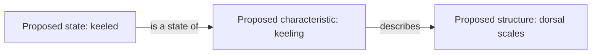

# Understanding the dictionary's records

The dictionary is designed to preserve both an interpretation and the wording
behind it. A researcher should be able to see a proposed concept, its alternative
expressions, the saved AI answers that supplied those expressions, and unresolved
questions about its meaning.

The main output uses **JSON**, a plain-text format for storing named fields,
lists, and records in a form that software can read. Readers do not need to know
JSON syntax to understand the dictionary. This guide explains the records first;
the developer section gives their exact software names.

## A concept is different from its wording

A **concept** is the biological idea that an expression is intended to name. An
**expression** is the wording used for that idea.

For example, the extraction answers include “dorsal scales” and “dorsals.” These
may be alternative expressions for the same concept in a particular context.
That equivalence is a proposal to evaluate, not a rule that similar-looking words
must always be combined.

One concept has one preferred expression for display. “Preferred” does not mean
that the project has established an official biological name or corrected the
original author's terminology. Other observed expressions remain attached with
their own references.

| Expression category | Meaning |
| --- | --- |
| Preferred | The expression selected to display this concept |
| Synonym | A proposed alternative expression for the same concept |
| Spelling variant | A different observed spelling proposed to name the same concept |
| Grammatical variant | An observed grammatical difference, such as singular/plural or an added article |
| Acronym | An observed shortened name; an expansion is recorded only when supported |
| Translation | An observed expression in another language proposed to name the same concept |

“MBSR” and “midbody scale rows” occur in the saved extraction material. The program
can represent a proposed abbreviation and its expansion when the cited records
contain the required wording. It cannot fill in an expansion merely because the
model knows one from elsewhere.

Language can be left unknown. A term derived from Latin is not automatically
treated as a foreign-language expression. The software does not independently
verify language identification or translation.

## Structures, characteristics, and states

The project uses four concept categories. The examples below illustrate the
distinctions; they do not certify the classification of a live experiment.

| Category | Plain-language meaning | Snake example |
| --- | --- | --- |
| Structure | An anatomical part or structure | Dorsal scales |
| Characteristic | An attribute that can describe a structure | Keeling |
| Character state | A particular form or value of a characteristic | Keeled |
| Unresolved | The system cannot confidently assign the concept to a category | An ambiguous extraction expression awaiting review |

A measurement is represented as a characteristic, with an additional measurement
classification. “Eye diameter” is an explanatory example of such a characteristic;
the system may use it as an expression only if the cited extraction observations
actually contain the wording. The program does not authorize invented umbrella
terms to make the dictionary look tidier.

## Relationships have a direction

Relationships state how two concepts may be connected. The direction matters:
“a characteristic describes a structure” means something different from its reverse.

This diagram is an illustration of the permitted structure of a proposal. It is
not evidence that the program or an investigator verified these particular links.

| Relationship | Meaning and allowed categories |
| --- | --- |
| Part of | A structure belongs within another structure |
| Subtype of | A narrower structure belongs to a broader structure category, or a narrower characteristic to a broader characteristic category |
| Describes | A characteristic describes a structure |
| State of | A character state belongs to a characteristic |

A concept may have more than one parent relationship without being duplicated.
For illustration, “head scales” could be proposed as part of “head” and as a
subtype of “scales.” These are two different claims about one concept. Each still
requires appropriate evidence and review.

The program rejects relationships pointing to missing concepts, relationships to
the same concept, and circular “part of” or “subtype of” chains. It also rejects
type errors, such as a characteristic being declared an anatomical part of a
structure.

## Keeping the original records

A **source record** preserves one saved extraction file, including its exact
bytes and available experiment details. An **observation record** preserves a
nonblank content line from that file, including lines the parser cannot interpret.

These observations are records of what an AI extraction produced. They are not
direct specimen observations. The dictionary's references lead back to extraction
answers; they do not automatically provide the original biological publication
or a supporting quotation from its species description.

The project records **provenance**, meaning the origin and history of a record.
Available provenance includes the source model, extraction run, source file,
original line, and connections from proposed expressions to observations.

Synonym and homonym claims remain in the original observation even when later
synthesis interprets them differently. A homonym is the same expression used with
different meanings. Identical wording alone is not permission to merge concepts.
Separate meanings can be recorded with sense and scope notes.

## Every observation needs an outcome

The program records how synthesis treated every observation. This outcome is
called its **disposition** in the software.

| Outcome | Meaning |
| --- | --- |
| Mapped | Its observed terminology is represented in one or more proposed concepts |
| Excluded | It remains preserved, but a reason explains why it was not made into a concept |
| Unresolved | It remains preserved, and the model explains why interpretation is uncertain |

Excluding a record does not delete it. Leaving it unresolved does not mean that
its terminology is meaningless. It makes the uncertainty visible.

A full comparative phrase containing anatomical terminology can be retained as
unresolved rather than promoted to a preferred dictionary expression. However,
the current rules do not allow the model to freely split that phrase and invent
new expressions. A mapped observation must keep its observed terminology among
the concepts it cites. This is a current constraint, not an implemented general
solution for descriptive sentences.

## What automated checking establishes

A **schema** is a set of rules describing the required fields and permitted
record types. **Validation** means checking a result against those rules and the
project's additional consistency checks.

The checks can establish, for example, that a concept has exactly one preferred
expression, that all referenced observations exist, and that mapped terminology
has not been lost. Errors prevent acceptance. Warnings flag matters that can
remain in a structurally acceptable result, such as unresolved meaning or shared
wording across concepts.

Validation does not establish synonymy, anatomical truth, or scientific consensus.
In this project, **inference** means a model's proposed interpretation based on
the supplied material. Every final relationship remains labeled as a proposal
based on model inference. There is no implemented transition to a scientifically
verified relationship within this output format.

## Developer reference: authoritative contracts

The runtime authority is `feature_dictionary/synthesis_core/schema.py`. The files
in `schemas/` are published JSON-schema counterparts checked by tests:

- `synthesis_candidate_v2.schema.json`: the model's candidate proposal.
- `feature_dictionary_v2.schema.json`: the assembled dictionary.

Both use strict field rules. Frozen input models reject ordinary field changes;
archived files themselves are not protected by filesystem read-only permissions.
Integrity validation detects discrepancies against saved source bytes.

| Type | Main fields or role |
| --- | --- |
| `Source` | `id`, `output_path`, `model`, `extraction_run_id`, `prompt_fingerprint`, `sha256`, `raw_bytes_b64`, `metadata` |
| `Observation` | `id`, `source_id`, `line`, `raw_text`, `category`, `observed_terms`, `synonym_claims`, `homonym_claims` |
| `InputBundle` | Frozen collections of sources, observations, and ingestion issues |
| `Expression` | `text`, `role`, `language`, `expansion`, `observation_ids` |
| `CandidateTerm` | Temporary `ref`, `kind`, optional characteristic/sense/scope details, expressions, notes |
| `CandidateRelationship` | `subject_ref`, `predicate`, `object_ref`, observation references, rationale |
| `CandidateDisposition` | Observation reference, `mapped`/`excluded`/`unresolved`, concept references, reason |
| `DictionaryProposal` | Candidate terms, relationships, observation dispositions, review notes |
| `Term`, `Relationship`, `Disposition` | Final forms using Python-assigned concept IDs |
| `SynthesisRun` | Model, optional response ID, prompt identity |
| `Issue` | Severity, code, path, message |

The final `Dictionary` contains `schema_version`, `status`, `synthesis_run`,
`sources`, `observations`, `terms`, `relationships`, `observation_dispositions`,
`issues`, and `review_notes`. Character states are typed terms, not a separate
collection. Relationships have `status: proposed` and `basis: model_inference`;
the dictionary has `status: proposed_requires_review`.

## Developer reference: identifiers and validation

An **identifier** is a label software uses to refer to a record unambiguously.
A **hash** is a content-derived identifier that helps detect changes. It does not
authenticate an approver or measure biological correctness.

`parse_source()` forms a source ID from its relative path and bytes. Observation
IDs add the original line number. Renaming a source therefore changes its source
identity. The parser preserves raw text while comparison normalization uses
Unicode normalization, case folding, and whitespace normalization. It does not
automatically remove hyphens or combine synonymous labels.

`validate_proposal()` reparses the saved bytes and checks the complete observation
ledger. It checks batch ownership when supplied, concept/expression uniqueness,
one preferred expression, supported wording, acronym expansion, evidence,
disposition completeness, relationship typing, and acyclic hierarchies.

For mapped observations, expression citations and disposition references must
agree. All `observed_terms`, including parsed synonyms, must remain represented.
Homonym claims are retained in observation records; the prompt asks for their
interpretation in notes, but the validator does not establish those meanings.

`resolve_term_ids()` hashes concept content, including citations and notes, after
specified sorting. These IDs are reproducible for the same assembled content;
they are not permanent ontology identifiers independent of an experiment.
`resolve()` converts temporary references to final IDs and constructs `Dictionary`.

There is no numeric confidence field. Current uncertainty is represented by
unresolved records, sense/scope notes, review notes, warnings, and proposal status.

Continue with [testing and reproducibility](testing-and-reproducibility.md).
