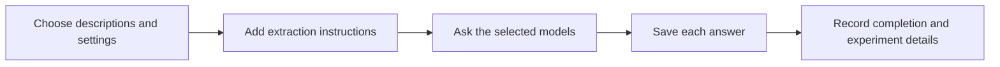

# How descriptions become candidate terms

Extraction helps researchers find morphological wording in the supplied snake
descriptions. It saves what each selected AI model returns so that differences
between models remain available for comparison.

Finding a term does not establish that it names a well-defined biological concept.
For example, **anterior chin-shields** is a candidate anatomical expression. The
longer wording **anterior chin-shields, which are as long as or a little shorter
than the posterior** also appeared in an extraction answer. The current pipeline
preserves that wording; it does not automatically determine that it is a suitable
dictionary entry.

## Preparing one experiment

The experiment starts with an input file and a set of settings. Settings specify
which models to use, which instructions to load, how much text to include, and
where to save results.

A **prompt** is the text of the instructions given to an AI model. The program
combines the extraction instructions with the selected input. It sends the same
combined text to each selected model, although the providers receive it through
different software interfaces.



Researchers can preview an experiment without sending a model request. A preview
shows the selected paths, models, approximate text size, and output filenames.
It does not reserve the destinations or establish that a later run will succeed.

## Which models are supported?

| Route | Supported model families | Where the model request goes |
| --- | --- | --- |
| Ollama, software for serving models locally | Qwen, DeepSeek, Llama, and other installed compatible models | The configured Ollama server |
| OpenAI | GPT | The selected cloud service |
| Anthropic | Claude | The selected cloud service |
| Google Gemini | Gemini | The selected cloud service |

Cloud services run outside the local Python program. They need credentials and
may charge for requests. An **application programming interface**, or **API**, is
the software connection used to send those requests and receive answers.

The test suite demonstrates that all six named model families can be selected
together through mocked responses: prepared substitutes for real service answers.
It does not prove that a particular model is installed locally or available to a
particular cloud account.

## What is saved?

Each answer is a **Markdown** file: ordinary readable text with simple markings
for headings, lists, and emphasis. The expected answer has a primary-term list and
a homonym section. A homonym is the same expression used for different meanings.

The following shows the expected presentation, not a verified biological finding:

```text
## Primary terms

* **dorsal scales** - synonyms: `dorsals` - homonyms:

## Homonyms

None found
```

The program also saves a log for each model and a summary of the run. A **run** is
one invocation of the extraction program. Logs record such details as the model,
instructions used, elapsed time, available usage counts, and completion reason.

**Metadata** means information about the experiment rather than its biological
content. Some metadata is stored in a comment at the beginning of the answer.
This allows later synthesis to associate the answer with its source run.

## Completed does not mean scientifically correct

A model may finish normally, reach its output allowance, refuse to answer, return
no text, or fail. Reaching the output allowance is reported as incomplete rather
than successful. Any returned partial text is retained.

A normally completed response can still omit terms, include nonmorphological
content, or confuse synonyms. Extraction does not yet check whether each returned
term is biologically appropriate. Synthesis applies further consistency checks,
and scientific review is still needed.

## Current settings and provider differences

The checked-in configuration selects GPT-5.4 Nano and the second extraction prompt.
It allows 1,200 output tokens and a 900-second request timeout. A **token** is a
piece of text counted by a model; it is not reliably one word. Some models also
use their output allowance for internal reasoning.

The 1,200-token setting remains an experimental choice, not a recommendation for
every input. Earlier term lists were cut short at this allowance. Starting points
of 4,096 for development and 8,192 for term-heavy inputs have been proposed, but
have not replaced the recorded setting or been established by this test suite.

Local Ollama models have an estimated text budget covering instructions, input,
and reserved output. A **context window** is the amount of text a model can work
with in a request. The local budget check is approximate. Cloud-only runs do not
use the Ollama budget, but cloud models still have their own limits.

Settings for randomness, local context size, repetition detection, and keeping a
model in memory apply to Ollama only. The cloud runners currently use their own
provider behavior for settings that are not passed explicitly. Equivalent prompt
text therefore does not mean identical model conditions.

## Protecting experimental answers

The program refuses to replace an existing answer filename. It reports the
conflict before initializing a provider client. Researchers can choose a fresh
output directory for a repeated experiment.

When logs are configured to append, new run records can be added to existing log
files. When appending is disabled, the program also refuses existing destination
logs and summaries. Non-conflicting answer filenames may share a directory.

A temporary directory reservation prevents two cooperating runs from using the
same output or log directory at once. A hard crash may leave a reservation behind.
It is not removed automatically because the program cannot safely assume that
the earlier run has stopped.

New run identifiers include a timestamp and a randomly generated identifier.
Permanent reservation receipts help detect reuse. These receipts show that a run
was reserved, not that all its models completed successfully.

## Developer reference: call sequence

1. `cli.main()` loads environment variables and parses arguments.
2. `_parse_models()` resolves cloud aliases or explicit `provider=model` values.
   `_overrides_from_args()` supplies overrides to `load_settings()`.
3. `ExtractorSettings` validates values; `resolve_settings()` creates
   `LoadedSettings`. Relative paths resolve against the settings file directory.
4. `read_text_file()` reads input. `RunContext.from_settings()` applies the optional
   character limit, then calls `render_prompt()`.
5. The dry-run branch calls `_print_dry_run()` and stops. Otherwise an applicable
   Ollama budget guard runs before `writers.reserve_run()`.
6. `_run_extraction()` checks installed Ollama models only when selected and
   groups execution as Ollama, OpenAI, Anthropic, Gemini.
7. `_execute()` calls `_run_single()` and `runner.run_model()` for Ollama.
   `_execute_cloud()` owns each cloud client and calls `_run_single_cloud()` with
   the selected provider's `run_model()`.
8. Each runner returns `GenerationOutcome`. `_write_outcome()` coordinates
   `write_output()` and `write_log()`. `_report()` and `write_summary()` finish
   reporting. Failed initialization/request paths create failure records.

Cloud jobs stay sequential. `max_concurrency` changes the Ollama group only.
Selection indices remain stable regardless of grouped execution order.

## Developer reference: configuration and output interface

The authoritative extraction configuration is `settings.json`, with validated
CLI overrides. The configured prompt is `prompts/extraction_v2.txt`;
`prompts/Initial Promt.txt` is retained but inactive. Either `prompt_file` or inline
`prompt` must be supplied, not both. If the placeholder is absent, `render_prompt()`
appends the input instead of silently losing it.

| Provider | Runner | Shared output-cap parameter |
| --- | --- | --- |
| `ollama` | `runner.py` | `options.num_predict`; an explicit value overrides `max_output_tokens` locally |
| `openai` | `runners/cloud_runner.py` | `max_output_tokens` |
| `anthropic` | `runners/anthropic_runner.py` | `max_tokens` |
| `gemini` | `runners/gemini_runner.py` | `config.max_output_tokens` |

With the shared cap unset, OpenAI/Gemini use provider defaults, Anthropic uses the
application fallback of 4,096, and Ollama retains its default. Timeouts use seconds
for OpenAI/Anthropic and milliseconds for Gemini. Cloud clients are closed by the
shared orchestration; local response streams are closed when stopped early.

Output paths retain `{index}_{model-slug}.md`; logs retain
`{index}_{model-slug}_{date}.md`. Summary logs use `summary_{date}.md`. Provider
metadata is derived from selection index, avoiding ambiguity when labels match.

Prompt identity includes the absolute template path, filename-derived version,
full template SHA-256, and short rendered-prompt fingerprint. A **hash** is a
content-derived identifier used to detect changes; the template hash identifies
instructions while the rendered fingerprint also reflects the included input.
It is not a scientific quality score or a record of who approved something.

Answer writing retains the historical outer-whitespace trimming behavior; it is
not a complete archive of every field in the provider's original response.

Exit codes are `0` for success, `1` for model failure, `2` for configuration,
destination or related setup errors, and `130` for interruption. Provider stop
reasons remain available in metadata/logs. Legacy request-error labels differ:
`error` for Ollama and `failed` for cloud exceptions.

For further details, see [the data records](data-contracts.md) and
[testing and reproducibility](testing-and-reproducibility.md).
