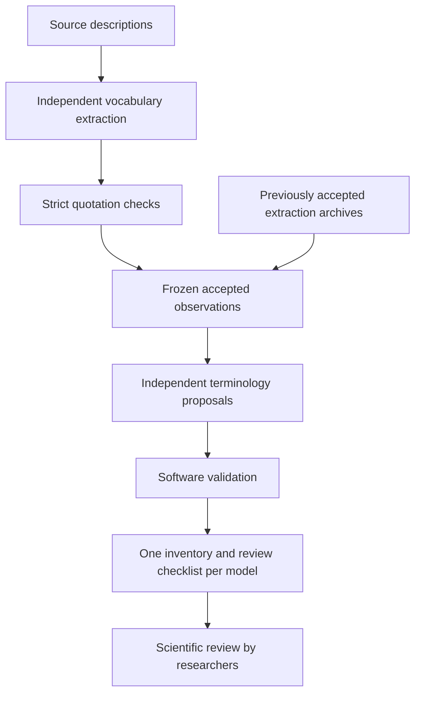

# From source descriptions to a reviewable anatomical inventory

This workflow connects the existing extraction and synthesis programs. Extraction
finds observed vocabulary and exact quotations. Synthesis proposes an anatomical
organization of that vocabulary. The exported inventory is a research proposal,
not a scientifically approved dictionary.

A **primary** names an independent anatomical structure or region. An indexed
**compound** names a structure or region using several words. A **contextual
expression** describes a primary or compound and stays beneath that entry. Thus
`anal entire` may describe `anal`, while `tail spine` may be indexed once and
shown under both `tail` and `spine`. These display links do not assert anatomical
containment. Classification depends on biological meaning, not just word count.



Raw responses, rejected evidence, and incomplete responses stay in their original
stage archives. Only accepted extraction documents enter the frozen synthesis
input. This version stops on a failed extraction stage; it does not silently
salvage rejected observations or rerun a failed model.

## Preview a new source without calling a model

From the project directory, with the virtual environment active:

```sh
python -m feature_dictionary.inventory_workflow \
  --source tests/fixtures/acanthophis_antarcticus_real.txt \
  --extractor-models qwen,gemini \
  --synthesis-models claude \
  --ollama-think false \
  --extraction-tokens 8192 --synthesis-tokens 16384 \
  --output-dir workflow_outputs/acanthophis_preview_01 \
  --dry-run
```

Replace the source path with another description. Repeat `--source` for multiple
files. Extraction and synthesis model selections are independent and use the
existing configured aliases and provider-qualified identifiers. A source dry run
checks the extraction configuration and previews synthesis selection. It cannot
validate the future synthesis input or its context budget before extraction has
produced observations. The plan explicitly records that limitation. It writes no
run directory and contacts no provider.

The workflow uses extraction candidate contract 3.1, prompt
`extraction_v3_1_4.txt`, synthesis contract 1.2, short observation references, and
new prompt `synthesis_inventory_v1_2_2.txt`. The new synthesis prompt clarifies
positional descriptors, pigmentation, and anatomical subtypes. All earlier
prompts and the existing extractor/modular-synthesis CLI defaults remain unchanged.
`--extraction-prompt` and `--synthesis-prompt` allow explicit version selection.

The new workflow requests native schema constraints for Ollama and Anthropic
extraction. `--ollama-output-format default` or
`--anthropic-output-format default` explicitly retains unconstrained requests.
Other provider execution stays unchanged. Thinking follows settings unless
`--ollama-think` is supplied. Token budgets follow settings unless their separate
stage overrides are supplied. Model support, context limits, credentials, and
service availability still depend on the configured providers. Live execution
checks required cloud credential names before either generation stage; it never
prints credential values.

Removing `--dry-run` permits generation and may incur provider charges. No live
requests were made while implementing this workflow.

## Reuse accepted extraction without paying for extraction again

Use a fresh workflow directory and explicitly select accepted archives:

```sh
python -m feature_dictionary.inventory_workflow \
  --reuse-extraction extractor_outputs/v314_gemini_8192_01 \
  --reuse-extraction extractor_outputs/v314_qwen_ctx16384_01 \
  --synthesis-models claude --synthesis-tokens 16384 \
  --output-dir workflow_outputs/acanthophis_reuse_preview_01 --dry-run
```

Directories or individual accepted document paths are supported. Mixing new
sources with reused archives is allowed. Duplicate archive selections fail strict
input validation. A directory containing no accepted documents is rejected.

There is no automatic retry or in-place resume. After interruption, retain the
partial run and start a fresh workflow using only explicitly accepted extraction
archives. To avoid rerunning a successful synthesis model, render its saved job
offline. To retry a failed synthesis model, select only that model in a new run.
Existing output directories are always rejected, even if they contain a partial
run. This is deliberately conservative about paid work.

## Export the successful archived Claude proposal offline

```sh
python -m feature_dictionary.inventory_workflow \
  --render-job synthesis_outputs/acanthophis_v12_short_claude_01/job_000 \
  --output-dir review_outputs/acanthophis_claude_short_review_01 \
  --reference-fixture tests/fixtures/reference/acanthophis_inventory_v1.json
```

No model credentials or provider calls are needed. Use a new destination each
time. The exporter verifies the frozen inputs and short-reference mapping, then
revalidates the original response. Saved derived proposals and validation reports
are not trusted as substitutes for replay. Older synthesis-1.2 proposals with
original observation IDs also work. Earlier synthesis contracts are not silently
converted.

Each proposal gets three files:

- `terminology_inventory.md`: alphabetical hierarchy, concise exact evidence,
  classification rationales, review status, exclusions, unresolved observations,
  and validation warnings. Shared compounds appear under multiple primaries but
  remain one stored record.
- `terminology_inventory.json`: the same independent proposal with temporary
  references, all frozen observations, exact locations, original source text,
  extractor provenance, original response, validation, and separate review status.
- `scientific_review.md`: prioritized questions about scope, case/plural variants,
  compounds, contextual attachments, exclusions, unresolved decisions and software
  findings. Screening flags do not change classifications or merge records.

`--reference-fixture` additionally writes `semantic_evaluation.json`. It compares
exact wording, roles, attachments, evidence, omissions, candidate repetitions, and
specified exclusions with provisional expectations. It archives the reference
contents and fingerprint. These expectations have **not** been approved by a
biological advisor. An expected term absent from the extraction input is reported
as not observed, not automatically blamed on synthesis. Exclusion quality still
needs expert judgment; not indexing an expression does not prove its exclusion
was appropriate.

Repeat `--render-job` to export several independent proposals. The root
`proposal_differences.md` highlights differing classifications, attachments and
coverage without creating agreement scores or merging output. Proposals with
different frozen input fingerprints are explicitly marked as uncontrolled
comparisons. A workflow run automatically produces these per-model exports in
`review/job_000`, `review/job_001`, and so on.

Invalid or incomplete proposals remain diagnostic inventories with a prominent
INVALID / UNAPPROVED label. Their records, raw response, missing decisions and
validation issues remain available. Malformed proposals include a raw appendix.
Screening is deliberately limited: example-based scope flags and case/plural
comparisons are review aids, not an anatomical ontology or an exhaustive detector
of biological mistakes. Every record still needs expert assessment.

No invalid record receives scientific approval. The software-validation status
on each item is conservative: it is true only when the entire proposal passed.

## Scientific review is a separate action

Every indexed term and contextual expression begins as
`needs_scientific_review`. Passing evidence checks, model agreement, or matching
the provisional reference cannot approve a biological interpretation. The export
itself always remains a proposal, even if a researcher reviews selected records.

For example, the successful archived Claude run indexes `distal` and
`dark cross-bands`. Both pass exact-evidence checks but are flagged for scope
review. They are not automatically moved or deleted. `upper labials` receives a
subtype question rather than a rule based on its grammar.

Optional reviewer decisions can be supplied through `--review-annotations` with
one `--render-job`. Keep the annotation file outside the immutable run. Its
contract is `scientific-review-1.0`, bound to the exported metadata's
`proposal_sha256` and `input_sha256`. Each entry in `decisions` has:

```json
{
  "path": "/terms/0",
  "decision": "approved",
  "confirmed": true,
  "reviewer": "Name of the actual reviewer",
  "reviewed_at": "2026-10-14"
}
```

The outer object also includes `format_version`, both fingerprints and the
`decisions` array. Decisions may be `approved`, `rejected`, or `needs_review`.
Contextual expressions use paths such as `/terms/0/expressions/0`. Only explicitly
confirmed, named reviews of this exact proposal affect the derived review status;
all other records remain pending. A new annotation file requires a new export
destination. This is an auditable manual declaration, not a reviewer identity
authentication system. Findings remain visible after review.

## Developer map and tests

- `inventory_workflow.py` coordinates existing extraction and modular synthesis
  entry points. It does not implement provider adapters or interpret evidence.
- `synthesis_core/review_exports.py` replays archives, derives per-record review
  views, uses the existing Markdown hierarchy renderer, and compares independent
  proposal views for review only.
- `synthesis_core/inventory_evaluation.py` handles the optional provisional
  reference comparison separately from schema/evidence validation.
- `tests/test_inventory_workflow.py` uses mocked providers and synthetic archived
  fixtures for success, invalid evidence, incomplete responses, collisions,
  multiple sources/models, archive reuse, offline rendering, and review binding.

```sh
python -m pytest
ruff check .
ruff format --check .
```

No final IDs, dictionary compilation, automatic biological reconciliation,
definitions, species classifications, or species-frequency analysis are present.
Publication requires advisor review of anatomical scope and terminology,
attachments, exclusions, ambiguity and equivalence proposals, followed by a
separately designed and reviewed publication process.
