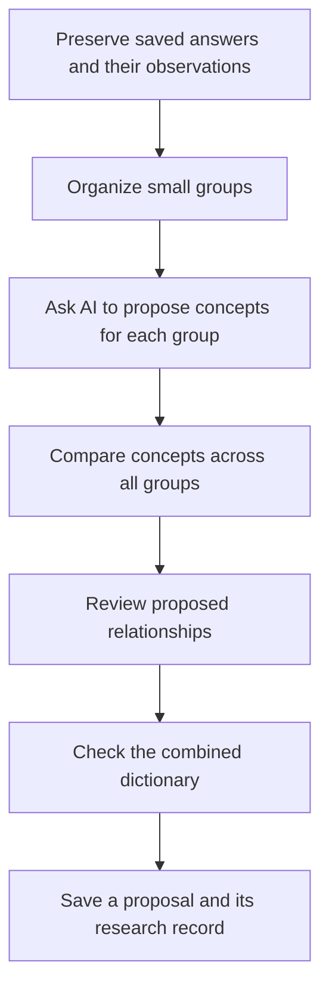

# Testing, saved experiments, and reproducibility

## Workflow scope and navigation

This guide preserves the **October 12, 2026** implementation, including legacy
staged synthesis. References to “current” behavior, defaults, tests, and deferred
features describe that checkpoint; do not assume its resume or correction behavior
applies to modular jobs.

For the current research baseline—extraction prompt **v3.1.4** and synthesis prompt
**v1.2.4**—start with the [user manual](USER_MANUAL.md),
[model-comparison guide](model-comparison.md), and [handoff report](GITHUB_HANDOFF.md).
See the [modular synthesis reference](modular-synthesis-v1-2.md) and
[connected workflow reference](inventory-workflow.md) for technical details.

This guide explains what the project preserves, what can be reconstructed without
another model request, and what the tests establish. It is intended to help both
teams distinguish a repeatable software result from a scientifically confirmed
interpretation.

**Reproducibility** here includes rebuilding a dictionary from the same saved
inputs and model answers. Asking a live AI model the same question again is a
different experiment and is not guaranteed to return the same answer.

## How a large synthesis task is divided

Synthesis organizes saved extraction answers into a proposed dictionary. A
**batch** is a manageable group of observations sent together for interpretation.
The starting size is configurable; the current default is about 30 observations.

Keeping batches small helps avoid answers being cut short. But a term in one batch
may be related to a term in another. The program therefore compares concepts
across the combined results instead of treating each batch as a separate final
dictionary.



**Reconciliation** means comparing proposed concepts before deciding whether to
combine them. For example, “dorsals” from one batch and “dorsal scales” from
another can be considered together. Similar wording does not itself justify a
merge, and identical wording may represent different senses.

The program accepts only explicit, compatible merge decisions. It preserves
uncertain or distinct senses. A chain of pairwise merge suggestions is not enough
to establish that every member of a larger group is equivalent.

## What relationship coverage means

After reconciliation, the program can review links between concepts originating
in different batches. It offers two levels of relationship review:

| Mode | What is examined | Important limitation |
| --- | --- | --- |
| Lightweight | Type-compatible concept pairs with shared words | May miss links between differently worded concepts |
| Comprehensive | All type-compatible directional concept pairs | More comparisons and potentially higher cost; still not a scientific guarantee |

These modes change relationship-review coverage, not the rule for whether two
concepts may be merged. The run record lists the scheduled comparisons completed.
It cannot prove that an AI thoroughly reasoned about every pair in a request.

Not proposing a relationship does not prove that no biological relationship
exists. “Comprehensive” describes the scheduled comparison coverage, not complete
biological knowledge or complete term extraction.

## What is preserved during synthesis?

Each staged synthesis experiment saves the extraction answers, observations,
settings, instructions, and record rules used for the run. These frozen records
allow later work to use the same experiment rather than whatever settings happen
to be current.

Each model request and returned answer is saved separately. Failed, incomplete,
and invalid attempts remain available. If an answer reaches its output allowance,
the program can divide the task into smaller groups while preserving the parent
attempt.

The archive preserves extraction answers, not an independent archive of every
original biological publication or the entire original species input. Researchers
still need to manage those scientific sources and the input used for extraction.

## Continuing and reconstructing a run

**Resume** means continuing an existing experiment. Successful saved jobs are
checked again and reused. New missing jobs may require model requests. A failed
or uncertain previous request is not silently charged for again: requesting a new
attempt requires the retry option, apart from the documented subdivision of
output-budget failures.

An **unknown outcome** means the archive contains a request but no saved response.
The service might have processed it before the local program stopped. The program
cannot honestly promise that retrying such a request is free.

**Offline replay** means reconstructing from saved material without contacting a
model service. Replay needs enough valid saved answers or accepted corrections
for the required jobs. It cannot invent a missing answer to finish a run.

The reconstruction engine can work without changing its input archive. The replay
command can still create new reconstruction reports and a requested dictionary.
“Offline” describes the absence of model requests; it does not mean every replay
command is a read-only inspection.

Reconstruction uses the currently installed checking and assembly software. Frozen
instructions and answers do not freeze all future Python behavior. Software and
dependency versions also matter when reporting an experiment.

## Correcting an AI answer without replacing it

A correction is saved as a separate record containing the edited candidate, an
explanation, approval flags, and its connection to the original request and
response. The original answer and its failed checks remain unchanged.

An **artifact** is a saved file produced during an experiment, such as a response,
report, or correction. Content-derived identifiers called **hashes** connect a
correction to particular archived files and help detect later changes. They do
not identify who approved the edit.

A correction must pass the job's checks before it can be reused. Accepted edits
are checked again on resume or replay. A final dictionary that uses them retains
an offline-edit warning and correction provenance: the origin and history of
the edit.

Acceptance means that the correction obeyed the software's rules. Neither a
manual edit nor an approval flag makes its biological interpretation verified.

## Current live experiment: a dated status record

The inspection on October 12, 2026 found three extraction sources and 220
observations in the live batched experiment. Its frozen plan uses GPT-5.4 Nano,
eight starting batches of up to 30 observations, lightweight relationship review,
and a 6,000-token output allowance per job. A token is a unit of model-processed
text, not necessarily one word.

Only the first two local batches have completion checkpoints. There is no final
dictionary or reconstruction for this live run. A checkpoint records completed
work; its absence is not proof that nobody ever inspected a candidate offline.

Batch 3's original answer retains seven validation errors. The separately edited
candidate has 20 concepts and 30 observation outcomes and currently passes its
offline checks with five warnings. The warnings include incomplete source lists,
shared wording, and unresolved concept categories.

**A correction was registered for batch 3.** Its saved correction is marked
accepted and manually approved. Its hashes match the original request, response,
frozen plan, input records, and edited candidate. The candidate text exactly
matches the separately proposed correction file.

However, an earlier instruction authorized preparation and checking of that edit
while withholding registration. The artifact contains no approver name, approval
time, or authorization reference that explains a later approval. Registration is
therefore established, while the authorization history remains unconfirmed.

There is no batch 3 completion checkpoint showing later live consumption. Resume
is designed to reuse accepted corrections after rechecking them, so the flag
should not be mistaken for independently established human authorization. This
documentation pass did not register, approve, remove, or apply any correction.

## What the tests establish

The last completed checkpoint reports **258 passing tests**, with code-style and
format checks passing. One existing warning comes from a Google software library's
compatibility with the installed Python version. The documentation work did not
rerun the application test suite or request live model answers.

Tests use **mocks**: prepared substitutes for real service responses. This makes
it possible to test failure conditions without paying for model requests.
**Deterministic** tests use controlled conditions to expect a repeatable result.

For example, a test can deliberately give a relationship the wrong direction,
remove an observation reference, or stop an answer halfway through. It then
checks that the program reports the problem and preserves the available records.

These tests establish software behavior under the tested conditions. They do not
measure how often a live model extracts correct terms, resolves synonymy well,
or proposes sound biological relationships. Those are separate research
evaluation questions.

## Developer reference: execution and archive layout

`synthesis.main()` dispatches staged work to `staged_cli.run()`. `plan()` freezes
observation aliases, batches, prompts, schemas, model, budgets, and coverage.
`create_run()` saves `inputs.json`, `plan.json`, and `manifest.json`.
`read_run()` checks plan/input integrity and reparses source observations.

`batching.execute()` takes a live-run lock when a client is supplied, then calls
`_execute()`. Its local jobs call `run_job()`, `decode_local()`, and
`validate_proposal(..., owned_ids=...)`. Comparison jobs use `bounded_reviews()`;
`reconcile()` applies explicit merges and updates links/dispositions. Global
validation runs before and after relationship review. `resolve_term_ids()` and
`resolve()` assemble the final dictionary without another model request.

```text
run-directory/
├── inputs.json
├── plan.json
├── manifest.json
├── run.lock
├── jobs/<local|reconcile|relationships>/<job-hash>/
│   ├── attempt_0001/
│   │   ├── request.json
│   │   ├── response.json
│   │   └── validation.json
│   └── corrections/<correction-hash>.json
├── checkpoints/<stage>/<job-hash>.json
├── assembly_reports/<report-hash>.json     When relevant
└── reconstructions/<timestamp-and-id>/
    ├── dictionary.json                    When assembly succeeds
    ├── validation.json
    └── run_summary.json
```

The published dictionary also has a `.run.json` provenance sidecar pointing to
the run archive and summary. Explicit overwrite paths archive prior published
content. The current live run has only a subset of the layout above.

## Developer reference: request reuse and corrections

`run_job()` identifies jobs from their request and frozen input identity. It first
checks accepted corrections through `corrections.reuse()`, then revalidates saved
attempts through `validate_job()`. A request is archived before transmission;
responses, errors, and validation reports are retained separately.

`max_output_tokens` exhaustion leads to recursive splitting of observations or
comparison lists. Missing/invalid/unknown jobs stop offline execution. Existing
failed attempts need `--resume --retry-failed` to authorize new requests, subject
to the output-budget split behavior. Successful jobs are reused without new calls.

`--correct-job` requires `--candidate`, `--correction-reason`, and
`--approve-correction`. `approve_job()` reaches the exact frozen job's validator
offline; `save()` creates a separate immutable artifact, even for a rejected edit.
`reuse()` verifies bindings and revalidates accepted edits. Final issues include
`OFFLINE_EDIT`; the summary includes correction provenance.

Live execution and correction registration use `fcntl` locks. A persistent
`run.lock` file alone does not establish that a process currently holds the lock.

The batch 3 artifact is under:

```text
synthesis_outputs/mid_batched_test/jobs/local/
  9bf1fb0e497096d0c2fcdb9059ce3cb95ea1d70bf80f6d582b9beb834cff92cb/
    corrections/
      1430371150c80613098b524394180c3a569cc891b5d6600af38d3abfba872aef.json
```

The earlier single-request route remains in `inference.request_synthesis()` and
`evaluate()`. It uses `prompts/synthesis.txt`. Staged jobs instead use the three
prompt constants in `batching.py`, frozen into the plan. Legacy `--replay` and
staged `--replay-run` are different archive interfaces.

## Developer reference: test map and no-cost commands

| Test file | What it exercises |
| --- | --- |
| `test_settings.py` | Defaults, overrides, path/prompt rules, invalid settings |
| `test_context.py` | Rendering, input limits, prompt identity, local budgets |
| `test_naming.py` | Safe slugs, indices, filenames, formatted measurements |
| `test_runner.py` | Ollama requests, streaming, metrics, repetition, interruption, cleanup |
| `test_writers.py` | Answer metadata, logs, summaries, append behavior, partial markers |
| `test_cli.py` | Extraction orchestration, missing models, previews, guards and interruptions |
| `test_cloud_extraction.py` | Cloud caps, completion reasons, retained partial text, metadata, local-budget exemption |
| `test_extraction_pipeline.py` | Six-model selection, equivalent prompt text, distinct outputs, failures, timeout, cleanup, ingestion |
| `test_extraction_safety.py` | Existing outputs/logs, directory occupancy/locks, run-ID reuse, late collisions |
| `test_synthesis.py` | Parsing, immutable input, validation, homonyms, uncertainty, legacy archives/replay, IDs |
| `test_synthesis_batching.py` | Cross-batch concepts/links, coverage, splitting, resume/replay, ownership, global consistency |
| `test_synthesis_corrections.py` | Accepted/rejected edits, bindings, original-byte preservation, approval flags, revalidation and reuse |

`tests/conftest.py` makes the package importable for tests. Synthetic examples in
`examples/` support reconstruction tests; they are not completed biological
experiments. Files such as `tests/250k` are local data, not Python tests.

From the project root, these commands use no paid model requests:

```sh
.venv/bin/python -m pytest
.venv/bin/ruff check .
.venv/bin/ruff format --check .
```

Tests can write temporary fixtures and local caches. A read-only staged preview
of the saved synthetic example is:

```sh
.venv/bin/python -m feature_dictionary.synthesis \
  --replay-run examples/synthesis_batched/run --dry-run
```

The existing `CHECKPOINT.md` records versions and content hashes for its tested
scope. This new documentation set is outside that original hash scope. Dependencies
are not locked by a reproducible installer file; replay should record the code
and environment used, not only the model name.
